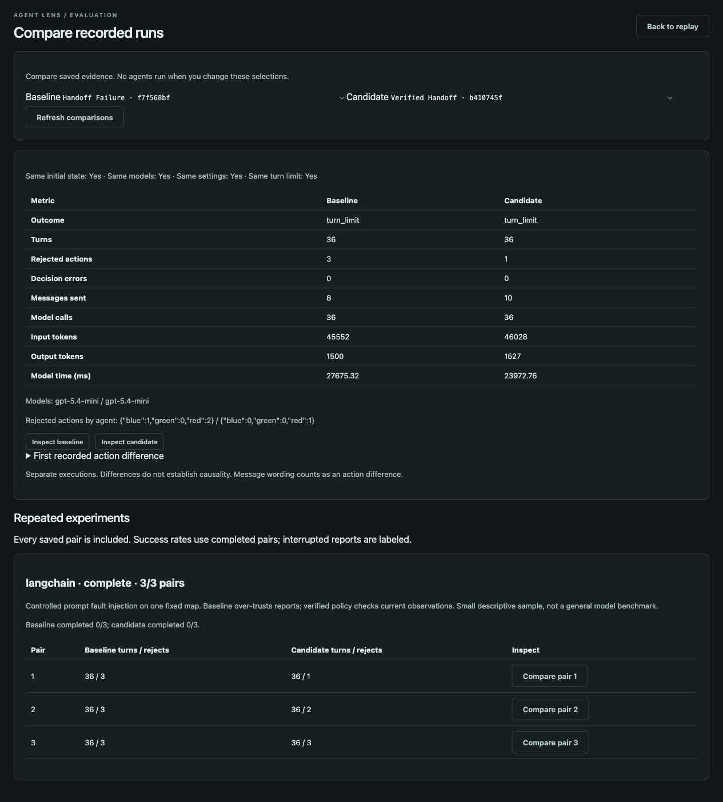

# AgentLens

**Replay multi-agent LLM runs and trace the evidence behind their actions.**

AgentLens is a local debugging and observability application built with FastAPI and React. It records what each agent observed, which messages and memories entered its context, the plan and action it returned, and the resulting environment changes. Inspect a saved run without executing agents or making another model call.

[Quick start](#quick-start) · [Debugging walkthrough](docs/debugging-guide.md) · [Architecture](docs/architecture.md) · [LangChain integration](docs/langchain.md) · [Measured case study](docs/debugging-case-study.md)

<details>
<summary>Preview the run comparison workspace</summary>



</details>

## What you can investigate

- **Conflicting evidence.** Compare a current observation with older messages, retrieved memories, and previous plans.
- **Communication failures.** Follow a report from sender to recipient, memory storage, retrieval, and a later decision.
- **Incorrect actions.** Inspect the exact submitted context, explicit plan, validated response, and environment result.
- **Changes between runs.** Compare outcomes, rejected actions, model calls, token usage, and request duration across saved executions.

The replay workspace includes a vertical event timeline, an 8×8 grid with global and agent perspectives, memory and message inspectors, and a graph of recorded event references. A separate workflow view supports LangChain callback recordings outside the grid.

## A concrete debugging example

In a live Verified Handoff run, Blue attempted to collect a resource at `(3, 4)` even though its current observation marked that cell empty. Its context still contained Green’s earlier report and a previous resource observation. Replay showed that Red had collected the resource between those observations and Blue’s action.

The debugger exposes this conflict and its recorded sources. It does not infer hidden reasoning or prove which input caused the decision.

A six-run pilot compared a deliberately over-trusting baseline with a verification policy. Rejected actions totaled **9 versus 6**, but **neither policy completed the task within 36 turns**. This is a small controlled experiment, not a general model benchmark. [Read the protocol, results, and limitations](docs/debugging-case-study.md).

## Quick start

Requirements: **Python 3.12+**, **Node.js 22 LTS**, and npm. The grid demo needs no API key.

```sh
git clone https://github.com/jiho-jason-kim/agent-lens.git
cd agent-lens
python3 -m venv .venv
source .venv/bin/activate
python -m pip install -r backend/requirements.txt
cd backend
python -m uvicorn app.main:app --reload --host 127.0.0.1 --port 8000
```

In another terminal, from the repository root:

```sh
cd frontend
npm ci
npm run dev
```

Open **http://127.0.0.1:5173**. Select **Scenarios**, choose **Mock** mode, and start **Handoff Failure**. Then create **Verified Handoff** and use **Compare** to inspect the two recordings. Mock policies are deterministic demonstrations; live agents can behave differently.

The commands above use a macOS/Linux shell. On Windows, activate the environment with `.venv\Scripts\Activate.ps1` in PowerShell.

## Optional live models

From the repository root, with the Python environment active:

```sh
python -m pip install -r backend/requirements-langchain.txt
cp backend/.env.example backend/.env
```

Set `OPENAI_API_KEY` and `OPENAI_MODEL` in `backend/.env`. Use a model that supports strict JSON Schema structured output. The backend reads this file automatically; existing shell variables take precedence. Keep the key on the backend, never in frontend variables. The `.env` file is excluded from Git.

Restart the backend, select **LangChain · live model decisions** in **Scenarios**, and create a run. Each turn invokes the model and incurs API charges. Replay and comparison only read saved recordings.

For a bounded 12-turn run:

```sh
cd backend
../.venv/bin/python -m app.scenarios.run verified-handoff --agent langchain --max-turns 12
```

The direct provider is also available through the API with `agent: "llm"`. See the generated API documentation at **http://127.0.0.1:8000/docs**.

## Scenarios

| Scenario | Investigation focus |
| --- | --- |
| Handoff Failure / Verified Handoff | Trusting reports versus checking current observations |
| Resource Race | Competing agents and resource contention |
| Cooperation | Private messages and individual collection goals |
| Misinformation | Tracing an injected false report through communication |
| Stale Memory | Previously accurate information after the world changes |
| Hidden Information | Differences between local observations and global state |
| Coordination | Assignments, arrival messages, and target occupancy |
| Tutorial | Single-agent collection and return home |

One turn is one agent decision, not a full round. Multi-agent simulations schedule Blue, Red, then Green. Agents receive local observations and private contexts; the debugger can inspect the full recording.

## Evaluation and tests

Run paired mock evaluations without API calls:

```sh
cd backend
../.venv/bin/python -m app.evaluation.run --mode mock --repetitions 3 --max-turns 36
```

Use `--mode langchain` for paid live evaluations. Each completed run is saved immediately. Resume an interrupted evaluation with `--resume eval-ID` and the same options. Open **Compare** to inspect the saved pairs.

Run the test suites from the repository root. Install the optional LangChain requirements for full integration coverage.

```sh
(cd backend && ../.venv/bin/python -m pytest -q)
(cd frontend && npm test && npm run build)
```

Tests cover context isolation, message delivery, memory provenance, snapshot reconstruction, provider failures, replay controls, and comparison. Provider tests use local fixtures rather than paid calls.

## Project structure

```text
backend/app/
  agent/          Mock and live model decision providers
  environment/    Grid rules, visibility, and action execution
  simulation/     Turn scheduler and event recording
  memory/         Per-agent storage and deterministic retrieval
  integrations/   LangChain callback recorder
  evaluation/     Saved-run comparison and paired experiments
  api/            FastAPI routes
frontend/src/
  components/     Replay, inspectors, provenance, workflows, comparison
  replay/         Recorded-event queries and graph construction
docs/             Walkthroughs, architecture, and experiment evidence
data/             Local generated recordings (excluded from Git)
```

## Scope and limitations

AgentLens is a local portfolio application. It uses JSON storage and synchronous run execution, without authentication or a production deployment configuration. Keep the API bound to localhost.

Replay is deterministic for a saved recording. New LLM executions can differ. Provenance represents recorded dependencies, not causal attribution. Plans are explicit model outputs, not hidden chain-of-thought. Agent views filter the debugger display and are not access-control boundaries.

Recordings may contain private prompt or tool data. Workflow redaction covers known keys and configured values, not all sensitive text. Generated recordings stay out of the repository; the checked-in pilot report contains selected experiment metrics. Full live pilot traces are local artifacts, so a fresh clone must generate its own runs.

Counterfactual execution, durable workflow checkpoints, and resuming an agent from a replay position are not implemented.
