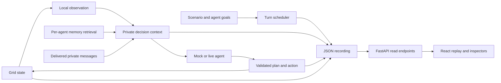

# Architecture and recording model

## Execution and replay

The runner schedules one agent at a time. It delivers pending messages before that recipient’s decision, records local perception and memory retrieval, constructs the context, and obtains a decision. The environment validates and executes the action. A completed action, including a rejected action, produces a delta and a snapshot.

Agents can occupy the same cell. Only the first successful collection receives a resource. A send action consumes a turn; its message arrives before the recipient’s next scheduled decision. Failed decisions preserve their available events but do not create a completed-action snapshot.

## Saved artifacts

Grid runs live in `data/runs/run-ID/` as `metadata.json`, `events.json`, and `states.json`. Schema version 1 covers the tutorial; version 2 covers multi-agent runs. The loader validates event ownership, references, context sources, and snapshot consistency. Validation is not protection against malicious tampering.

Each event records `event_id`, `run_id`, `turn`, `agent_id`, `type`, `timestamp`, `payload`, `input_refs`, and `effect_refs`. References connect recorded inputs to later events. IDs are unique within a run, not globally.

Event families include observations, messages, memory writes and retrievals, model calls, plans, actions, environment deltas, scenario instructions, completion, and errors. New model-call events preserve instructions, submitted context, validated output, prompt hash/version, requested model/settings, duration, and available token counts. Older recordings may lack these fields.

`states[0]` is the initial world. For a completed turn `t`, `states[t - 1]` precedes the action and `states[t]` follows it. The global grid uses snapshots; agent perspectives use recorded local observations and label the observation’s actual turn.

## Memory and provenance

Each agent has its own memory store. Writes preserve observations, received reports, and action results. Retrieval selects up to four entries using deterministic age, source, and token-overlap scores. No embedding model is required. Old memories can remain available after the world changes.

The provenance graph follows saved references only, with a 40-event display limit. Message receipt, memory creation, retrieval, context, model response, action, and environment result can be inspected as separate artifacts. An edge establishes a recorded relationship, not a psychological or causal explanation of model behavior.

## API map

| Route | Purpose |
| --- | --- |
| `GET /scenarios` | Scenario catalog |
| `POST /runs` | Execute and save a grid run |
| `GET /runs?schema_version=2` | List multi-agent runs (default version is 1) |
| `GET /runs/{id}` | Complete saved grid recording |
| `GET /runs/{id}/events` | Saved events |
| `GET /runs/{id}/states` | Saved snapshots |
| `GET /evaluations` | Saved paired reports |
| `GET /evaluations/compare?left=run-ID&right=run-ID` | Compare saved runs |
| `GET /workflows` | List callback recordings |
| `GET /workflows/{id}` | Complete saved workflow |
| `POST /workflows/demo` | Execute the bounded workflow example |

See `/docs` on the local backend for request schemas. Read endpoints do not execute agents. Workflow recordings use a separate schema and directory. See [LangChain integration](langchain.md).
